  <picture></picture>

  <picture></picture>

## About

Software developer focused on building reliable applications, automation and small utilities. I work with **Go**, **Python** and **TypeScript** on Linux, caring about clean architecture, performance and developer experience.

  <picture></picture>

## Stats

  <picture></picture>
  <picture></picture>

  <picture></picture>
  <picture></picture>

  <picture></picture>

  <picture></picture>

## Skills

  <picture></picture>
  <picture></picture>
  <picture></picture>
  <picture></picture>
  <picture></picture>

  <picture></picture>

## Connect

  
  
  
  
  

  <picture></picture>

