  

  

<h1 align="center">trigrilloo20</h1>

  

  

## About

I'm **trigrilloo20**, a backend & infrastructure engineer from México 🇲🇽 focused on **servers, hosting**. I run **GalaxityHosting INC**, where I manage my own projects end to end — including free hosting, Discord bots with web dashboards, and a Minecraft server community.

- 🖥️ Backend development with **Go** and **Node.js** — REST APIs, microservices, WebSockets & JWT auth
- 🐳 Containers & virtualization: **Docker**, **Proxmox VE**, **KVM / LXC**
- 🎮 Game server infrastructure with **Pterodactyl** — Minecraft & multi-server hosting
- 🌍 Hosting stack: **cPanel**, **WHM**, **CyberPanel**, reverse proxies & SSL/TLS management
- ☁️ Cloud & networking: **Cloudflare**, **Hetzner**, DNS, WireGuard, firewalls & load balancing
- 🐧 Linux sysadmin on **Arch**, **Debian** and **Ubuntu** — systemd, SSH & hardening
- 🗄️ Databases: **PostgreSQL**, **MySQL**, **MongoDB**, **Redis**
- 🤖 Discord bots & management panels with **TypeScript / Node.js**
- 🌐 More about me: **[trigri.galaxity.lol](https://trigri.galaxity.lol)**

  

## Stats

  

  
  

  
  

  

## Tech

  
  
  
  
  

  
  
  
  
  
  

